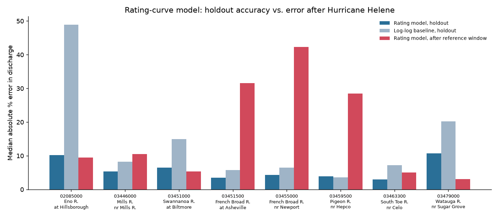
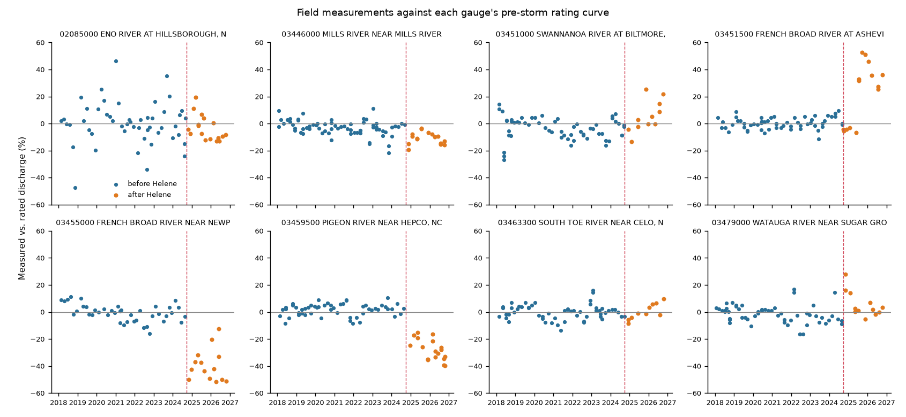
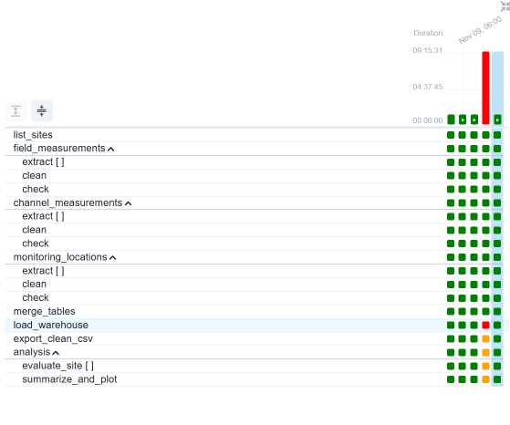
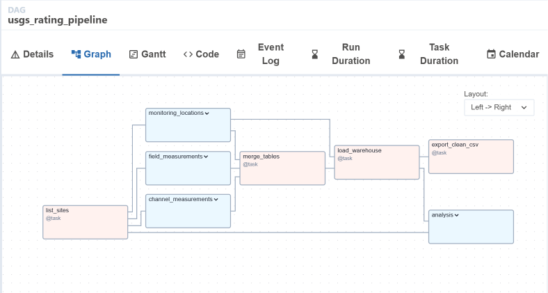
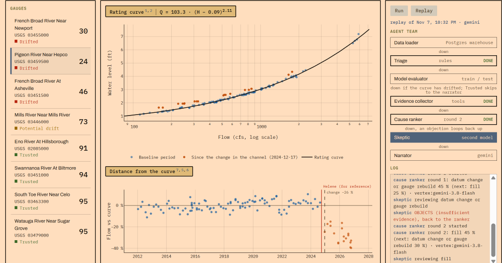
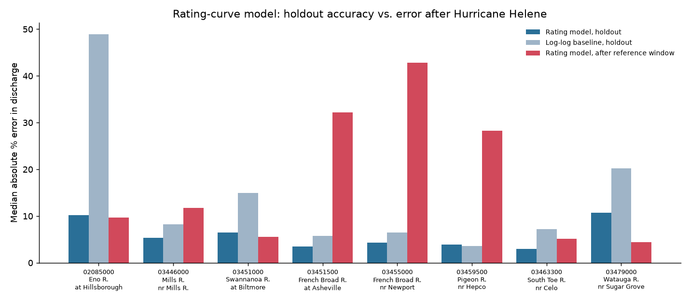

# DriftWatch HW: an Airflow pipeline and an agent workflow for USGS rating curves

A USGS stream gauge records the water level (stage). A **rating curve** turns that stage into
discharge (flow). Hydrographers check the curve with field measurements. When a flood rearranges
the channel, the measurements drift off the curve, and the published flows stay wrong until
someone redraws it. Hurricane Helene (Sept 2024) did exactly this to several gauges in western NC.

> **Origin:** I built DriftWatch for the Triangle AI Hackathon (Nov 6–8, 2026). The rating-curve
> model, drift test, trust score, LangGraph agent team and console all come from that build
> (original README: [`docs/DRIFTWATCH_README.md`](docs/DRIFTWATCH_README.md)). The first commit in
> this repo is that hackathon code unchanged, so `git diff` against it shows exactly what's new for
> this assignment.

For this assignment I added:

- **Part 1:** a scheduled Airflow DAG that ingests three related USGS tables, cleans them in
  parallel, merges them, loads Postgres, and trains and evaluates a model from the database.
- **Part 2:** the LangGraph agent team reads that cleaned data from Postgres. Two new agents load
  the data and train/evaluate the rating model, and the live agent graph in the console shows
  both.

```
                 ┌──────────────── Part 1: Airflow (scheduled daily) ────────────────┐
 USGS snapshot ─▶│ 3 tables × 8 gauges ─▶ clean ─▶ merge ─▶ Postgres ─▶ model + plots │
                 └───────────────────────────────────────────┬────────────────────────┘
                                                             │ warehouse.measurements
                 ┌──────────────── Part 2: LangGraph agents ─▼───────────────────────┐
                 │ data_loader ─▶ triage ─▶ model_evaluator ─▶ (evidence ─▶ ranker ⇄  │
                 │                                             skeptic) ─▶ narrator    │
                 └────────────────────────────────────────────────────────────────────┘
```

## Quick start

You need Docker Desktop and, for the local commands, Python 3.11+ and `make`. Commands are
PowerShell, but they work the same in bash.

```powershell
git clone <this repo>; cd DAG_HW
docker compose up -d --build      # Airflow :8080 (admin/admin), warehouse :5433, console :8000
```

1. Open **http://localhost:8080**. The DAG `usgs_rating_pipeline` starts unpaused and runs on its
   schedule. To run it now, click ▶ **Trigger DAG**, or run `make trigger`.
2. Wait about a minute for every box in the Graph view to turn green. Results land in
   `artifacts/pipeline/latest/` and in Postgres (`warehouse` database, tables `sites`,
   `measurements`, `pipeline_runs`).
3. Open **http://localhost:8000**, pick a gauge, and click **Run**. The agent graph lights up node
   by node, and the `data loader` line in the log says `from the warehouse`.
4. Score the agents on all 8 gauges: `make evaluate-docker`. This writes
   `artifacts/agents/evaluation.md`.

Without Docker (snapshot data, no Airflow):

```powershell
python -m venv .venv; .venv\Scripts\python.exe -m pip install -e ".[dev,agents,api,warehouse]"
make test          # pytest, offline, never calls an LLM
make evaluate      # agents on all 8 gauges, rules-only (LLM=fallback)
make serve         # console at http://localhost:8000
```

`.devcontainer/` gives a Python 3.11 editor environment. It doesn't contain Airflow: start the
compose stack on the host first, and the devcontainer reaches the warehouse at
`host.docker.internal:5433`.

To point local runs at the Docker warehouse, set `$env:DRIFTWATCH_SOURCE="warehouse"`
(`WAREHOUSE_URL` defaults to `localhost:5433`).

---

## Part 1: Airflow pipeline

### Data sources

All three tables come from the [USGS Water Data OGC API](https://api.waterdata.usgs.gov/ogcapi/v0).
They're cached per gauge in `data/snapshot/<site>.json`, so the DAG is reproducible offline.
The extract tasks read that cache, so each daily run reprocesses the same data and doesn't pull
new measurements. To fetch fresh data, run `make snapshot SOURCE=live` before the DAG. The
cache covers 8 gauges: 7 in the Helene area plus the Eno River at Hillsborough as a control.

| Table | One row is | Used for | Join key |
|---|---|---|---|
| `field-measurements` | one reading at a field visit (stage, discharge, rating, control note) | the stage/discharge pairs the model is fit on | `field_visit_id` + `time` |
| `channel-measurements` | the cross-section behind a discharge measurement (area, velocity, width) | evidence of scour/fill | `field_visit_id` + `time` |
| `monitoring-locations` | one gauge (name, county, drainage area, datum, lat/lon) | site attributes | `monitoring_location_id` |

### Transformations (`driftwatch/pipeline/transform.py`)

- **Field:** pair each discharge (parameter 00060) with the stage (00065, reading type
  `MeanGageHeight`) at the same `(field_visit_id, time)`. Drop discharges with no stage, with two
  conflicting stages, or with non-positive values. Normalize quality ratings and map them to
  weights (Excellent 4 → Poor 1). Flag, but keep, Poor measurements taken at the Helene peak
  (2024-09-26..28). Those are left out of the drift test but stay in the plots. A test checks that
  this pandas version produces exactly the same rows as DriftWatch's original pairing code at all
  8 gauges.
- **Channel:** convert to numbers (blank, zero or negative becomes null) and collapse to one row
  per key. A "split channel" key (several rows) keeps its count but gets no geometry, because
  there's no documented way to combine the parts.
- **Sites:** keep the descriptive fields, typed.
- **Merge:** paired field rows LEFT JOIN channel LEFT JOIN sites. The merge asserts that the row
  count doesn't change.
- **Leakage rule:** channel area and velocity are evidence only, never model inputs. Discharge
  *is* area × velocity, so using them would leak the answer.

### Pipeline structure (`airflow/dags/usgs_rating_pipeline.py`)

```
list_sites
  ├─▶ [field_measurements]   extract ×8 (mapped) ─▶ clean ─▶ check
  ├─▶ [channel_measurements] extract ×8 (mapped) ─▶ clean ─▶ check
  └─▶ [monitoring_locations] extract ×8 (mapped) ─▶ clean ─▶ check
                    ▼
            merge_tables ─▶ load_warehouse ─┬─▶ export_clean_csv
                                            └─▶ [analysis] evaluate_site ×8 (mapped) ─▶ summarize_and_plot
```

- **TaskGroups:** one per source table, plus `analysis`.
- **Parallelism:** the three table groups have no dependencies on each other, so the
  LocalExecutor runs them at the same time. Inside each group, `extract` is a dynamically mapped
  task, one instance per gauge. That's 24 extracts, with up to 16 running at once
  (`AIRFLOW__CORE__PARALLELISM=16` in `docker-compose.yml`). `evaluate_site` fans out per gauge
  the same way. `export_clean_csv` runs alongside the analysis.
- **Scheduling:** `schedule="0 6 * * *"` (daily, 06:00 UTC), `catchup=False`,
  `max_active_runs=1`, one retry per task. Each run writes to its own folder
  (`artifacts/pipeline/runs/<run_id>/`). `load_warehouse` replaces the tables in a single
  transaction and logs the run in `pipeline_runs`, so re-running a day is safe (idempotent).
- **Quality gates:** each `check` task fails the run (red box) if a table comes out empty, has
  duplicate keys, or has non-positive stage/discharge. Bad data never reaches Postgres.

### Analysis: train and evaluate a model from the database

`evaluate_site` reads each gauge back out of Postgres and fits the rating-curve model, a weighted
power law `Q = a(H − e)^b` (robust Huber regression). The split is **chronological**: train on the
oldest 80% of the pre-Helene reference measurements, test on the newest 20%. A time split mimics
real use, because the curve is always applied to future measurements.

- **Metrics:** MdAPE (median absolute % error in discharge), and *accuracy*, defined as the share
  of test measurements within ±10% of the curve.
- **Baseline:** a plain log-log line, `Q = cH^d`.
- **Drift:** the same metrics on measurements taken *after* the reference window. The **drift
  ratio** is post-storm error divided by holdout error. About 1 means the curve still fits; much
  more than 1 means the channel moved.

### Results (run of 2026-11-09, `artifacts/pipeline/latest/`)

The scheduled run loaded **6,410 paired measurements** from 8 gauges into Postgres in about 45 s.

**How to read the table:** one row per gauge. The *holdout* columns score the model on the newest
20% of its own pre-storm data. *Within ±10%* is the accuracy figure. *After window* is the same
model scored on measurements taken after the reference window (after Helene for 7 gauges; after
2025-07-06 for the Eno control). *Drift ratio* = after-window error ÷ holdout error.

| Gauge | Holdout error | Within ±10% | Baseline error | After-window error | Drift ratio |
|---|---|---|---|---|---|
| 03459500 Pigeon R. nr Hepco | 3.9% | 95% | 3.6% | 28.3% | **7.3** |
| 03455000 French Broad nr Newport | 4.4% | 81% | 6.5% | 42.8% | **9.8** |
| 03451500 French Broad at Asheville | 3.5% | 91% | 5.7% | 32.2% | **9.3** |
| 03446000 Mills R. nr Mills River | 5.4% | 82% | 8.2% | 11.7% | 2.2 |
| 03451000 Swannanoa R. at Biltmore | 6.5% | 70% | 15.0% | 5.5% | 0.8 |
| 03463300 South Toe R. nr Celo | 2.9% | 91% | 7.2% | 5.2% | 1.8 |
| 03479000 Watauga R. nr Sugar Grove | 10.7% | 45% | 20.3% | 4.4% | 0.4 |
| 02085000 Eno R. at Hillsborough | 10.2% | 47% | 48.9% | 9.7% | 1.0 |

Both error columns use the same trained model (fit on the oldest 80%), so the drift ratio compares
like with like.

- The rating model beats the log-log baseline at 7 of 8 gauges. The median holdout error is
  4.9%, against 7.7% for the baseline. At Hepco the two tie.
- **Helene broke three ratings.** Hepco, Newport and Asheville fit their own holdout to within
  about 4%, then miss post-storm measurements by 28–43%. That's a 7–10× jump, so the model didn't
  get worse; the river changed. Mills River drifted mildly (2×). The others still fit.
- Watauga and Eno score low on holdout accuracy (about 45%) but don't drift afterwards. Those
  curves are noisier, not broken.




---

## Part 2: Agent workflow

The in-class loop is data scientist → hypothesis → ML engineer → judge. DriftWatch's team has the
same shape, applied to one gauge: rules triage the gauge, an LLM ranks causes, a second model
(the Skeptic) challenges the ranking and can send it back up to 2 times, and a narrator writes the
finding. Each LLM node has a rules-only fallback (`LLM=fallback`), which tests and grading use.

**What I changed for the HW** (`driftwatch/agents/graph.py`):

| Agent | Change | What it does |
|---|---|---|
| `data_loader` | **added** | Reads the gauge's cleaned rows from the Part 1 Postgres table when `DRIFTWATCH_SOURCE=warehouse`. If the DB is down, it falls back to the snapshot and logs why. |
| `model_evaluator` | **added** | Trains and tests the rating model on the warehouse rows (same split, baseline and metrics as the DAG), logs the scores, and adds them to the facts. Only the LLM ranker reads those facts. Routing still follows the triage band, and the rules-only fallback ignores the scores. So this node reports model quality; it doesn't steer decisions. |
| `triage` | modified | Now runs after the loader and keeps its facts. The Trusted / Watch / Stale routing decision moved to after `model_evaluator`. |
| `evidence_collector` | modified | Its channel-geometry tool reads channel rows from the warehouse table when one is loaded. |
| console graph | updated | `driftwatch/api/console.html` shows the two new nodes and logs their results live. |

The **live agent graph** is the console at http://localhost:8000. Each node lights up as its
trace event streams in.

### Evaluation

`python -m driftwatch.cli evaluate` runs the team on all 8 gauges and writes
`artifacts/agents/evaluation.{md,csv}`.

Results with `LLM=fallback`, reading from the warehouse:

- **Trust-band accuracy: 8/8.** Hepco, Newport and Asheville come out *Stale* (drifted), Mills
  River *Watch*, and the other four *Trusted*. Caveat: these labels come from DriftWatch's own
  eval file (`evals/cases.yaml`), which was written during the hackathon with the outputs in
  view. Treat 8/8 as a regression check, not an independent test.
- The model_evaluator's drift ratio agrees with the band. Every Stale gauge is above 7, and every
  Trusted gauge is below 2.
- The agents name a likely cause for each drifted gauge (fill at Hepco and Newport, scour at
  Asheville, debris at Mills River). Trusted gauges skip the cause-finding branch.
- Reading from Postgres changes nothing: a test checks that the warehouse path gives the agents
  the same measurements, channel rows and trust band as the original snapshot path.

---

## Screenshots

### Airflow: DAG runs (Grid view)

Each column is one DAG run, and each row is one task or task group (green = success). The
`[ ]` rows are mapped tasks, one instance per gauge.



The red column is the scheduled run for Nov 9. It started at 07:03 UTC instead of 06:00 and ran
for about 9 hours, so it was interrupted somewhere along the way. Then `load_warehouse` failed: gauge 03446000's site record never made it into the `sites` table, so
Postgres rejected that gauge's measurements on the foreign-key check. Nothing loaded, because the
load is one transaction. The orange boxes are the downstream tasks Airflow skipped as a result.
The rerun right after it (rightmost column) succeeded.

### Airflow: DAG structure (Graph view)

The three source-table TaskGroups run side by side, then feed `merge_tables` and
`load_warehouse`. After the load, `export_clean_csv` and the `analysis` group run in parallel.



### Agent graph (console)

The live agent team in the console, for Pigeon River near Hepco: the agent graph is on the right,
and the rating curve and each measurement's distance from it are on the left.



### Model evaluation results

Typical error of the rating model on its holdout (dark blue), the log-log baseline on the same
holdout (light blue), and the rating model after the reference window (red).



The full per-gauge table is in `artifacts/pipeline/latest/model_metrics.csv`. The agent scores are
in `artifacts/agents/evaluation.md`.

## Repo map

```
airflow/dags/usgs_rating_pipeline.py   the DAG (wiring only)
driftwatch/pipeline/                   transform.py, warehouse.py, analysis.py (DAG logic)
driftwatch/modules/rating_curve/       rating model, evaluate.py (train/test), drift test, report
driftwatch/agents/graph.py             LangGraph team (data_loader + model_evaluator added)
driftwatch/api/console.html            live agent graph
docker-compose.yml, infra/Dockerfile.airflow, Dockerfile, .devcontainer/   containers
tests/test_pipeline.py                 pipeline tests (plus the original DriftWatch suite)
```
